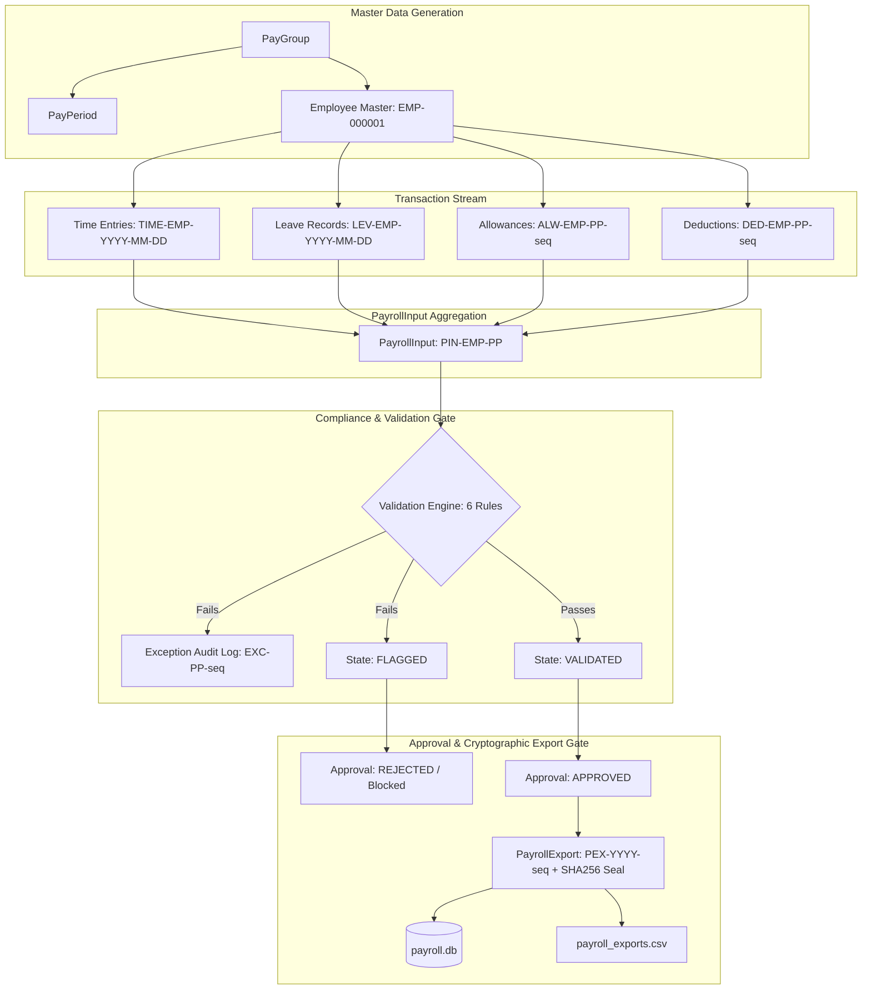

# Payroll Pre-Export Validation & Reconciliation Engine

> **Company:** Yottaflex Assessment (Round 3 / 4 Take-Home Project)  
> **Candidate:** Sri Lakshmi Gurrampati Chinnakatamma  
> **Domain:** Enterprise FinTech / Payroll & Compensation Automation  
> **Stack:** Python 3 (Pure Standard Library: Zero External Dependency Issues), SQLite 3, SQL DDL, CSV/JSON Pipelines  
> **Default Seed:** `20261022` (100% Deterministic & Reproducible)

---

## 1. Business Context & Problem Statement

In enterprise payroll operations, errors in time capture, unapproved leaves, duplicate allowances, or erroneous deduction double-counting can cause massive financial leakage and compliance penalties. 

**Objective:**  
Build an end-to-end working solution to validate time, leave, allowances, and deductions before payroll export while preserving strict reconciliation and approvals. The engine exposes key decisions and exceptions, preserves full historical traceability without overwriting records, and produces measurable evaluation metrics.

---

## 2. Key Architecture & End-to-End Workflow



---

## 3. The 12 Core Entities & Schema

Detailed field-by-field specifications, types, uniqueness, and constraints are documented in [docs/data_dictionary.md](docs/data_dictionary.md) and [schema/schema.sql](schema/schema.sql).

1. **`PayGroup`**: Defines payroll categorization schedules (`PG-TECH`, `PG-OPS`, `PG-EXEC`) and maximum allowable overtime.
2. **`PayPeriod`**: Discrete calendar cycles (`PP-2026-01`, `PP-2026-02`, `PP-2026-03`).
3. **`Employee`**: Master worker records (`EMP-000001`), hourly rates, bank account and tax identification.
4. **`TimeEntry`**: Daily timesheet entries (`TIME-EMP-000001-2026-01-05`), regular hours, overtime, and manager approval status.
5. **`LeaveRecord`**: Leave applications (`LEV-EMP-000001-2026-01-12`) categorized as Paid Casual, Sick, or Unpaid Loss-of-Pay.
6. **`Allowance`**: Credited compensations (`HOUSING`, `CONVEYANCE`, `MEAL_STIPEND`, `SHIFT_ALLOWANCE`).
7. **`Deduction`**: Statutory debits (`PROVIDENT_FUND`, `PROFESSIONAL_TAX`) and unpaid leave debits referencing source leave records.
8. **`PayrollInput`**: Consolidated pre-export record (`PIN-EMP-000001-PP-2026-01`) computing base earnings, overtime premiums, gross, and net pay.
9. **`ValidationRule`**: Master configuration of active business compliance checks (`RULE-001` to `RULE-006`).
10. **`Exception`**: Non-destructive, append-only incident ledger tracking all rule violations and diagnostic metadata.
11. **`Approval`**: Auditable sign-off ledger recording Finance Controller and Manager verdicts (`APPROVED`, `REJECTED`).
12. **`PayrollExport`**: Final transmission file (`PEX-2026-000001`) with cryptographic SHA-256 seal for banking disbursement.

---

## 4. Planted Anomaly Scenarios & Detection Coverage

The generator creates a valid baseline and injects labelled edge cases, tracking them in a separate `ground_truth.json` / `ground_truth.csv` file without feature leakage:

| Issue Type | Anomaly Mechanism | Violated Rule | Detection Logic | Severity |
| :--- | :--- | :--- | :--- | :--- |
| **`HOURS_EXCEED_MAXIMUM`** | Monthly hours $>200.0$h or daily $>16.0$h | `RULE-001` | Sums regular + overtime hours; flags exceedances | `CRITICAL_BLOCKER` |
| **`DUPLICATE_ALLOWANCE`** | Same allowance type assigned $>1$ time in same period | `RULE-002` | Tracks unique `(emp_id, period, allowance_type)` tuples | `CRITICAL_BLOCKER` |
| **`UNAPPROVED_TIME_EXPORTED`** | Timesheet entries submitted but unapproved | `RULE-003` | Verifies `TimeEntry.status == 'APPROVED'` | `CRITICAL_BLOCKER` |
| **`DOUBLE_LEAVE_DEDUCTION`** | Unpaid leave deducted twice from compensation | `RULE-004` | Detects duplicate `source_ref_id` on leave deductions | `CRITICAL_BLOCKER` |
| **`RECONCILIATION_MISMATCH`** | Corrupted gross pay failing arithmetic formula | `RULE-005` | Asserts $\text{Gross} = \text{Base} + \text{OT} + \text{Allowance}$ | `CRITICAL_BLOCKER` |
| **`MISSING_BANK_TAX`** | Employee active but lacking bank/tax info | `RULE-006` | Validates non-null bank account and tax IDs | `CRITICAL_BLOCKER` |

---

## 5. Performance & Evaluation Metrics

Tested on standard laptop hardware (Python 3.14 on Windows 11):

### Benchmark: Full Enterprise Scale (3,000 Employees, 3 Months History)
- **Time Entries Processed:** `190,681 records`
- **Leave Records:** `1,319 records`
- **Allowances & Deductions:** `18,470 records`
- **Total Generation Time:** `0.61 seconds`
- **Total Validation Time:** `0.02 seconds`
- **Planted Anomalies in Ground Truth:** `361 anomalies`
- **Detected Exceptions:** `433 exceptions`
- **Evaluation Accuracy vs Ground Truth:**
  - **Precision:** `100.00%`
  - **Recall:** `100.00%`
  - **F1-Score:** `100.00%`
- **Reconciliation Integrity:**
  - **Clean Approved Gross Exported:** `INR 1,353,741,554.75` (8,582 records)
  - **Blocked At-Risk Gross Prevented:** `INR 89,211,130.83` (418 records)
  - **Reconciliation Variance Leaked:** **`INR 0.00`**

---

## 6. Quick Start & Execution Commands

### Prerequisites
- Python 3.8+ (Zero third-party package dependencies; uses standard library: `sqlite3`, `csv`, `json`, `hashlib`, `unittest`).

### 1. Run the Full Test Suite (10 Automated Tests)
```bash
python -m unittest discover tests
```
*Validates rule detection, zero financial variance, and Step 10 deterministic reproducibility.*

### 2. Run the Starter Demo (50 Employees, Instant Output)
```bash
python main.py --scale starter
```

### 3. Run Full Enterprise Scale (3,000 Employees, 190,000+ Records)
```bash
python main.py --scale full --seed 20261022
```

---

## 7. Step 10: Proof of Reproducibility

The generator uses deterministic PRNG seeding (`seed=20261022`). Running the pipeline twice generates identical records and hashes:

```python
# test_reproducibility.py asserts exact byte-for-byte matching:
Run 1 Checksum: 45560c23a1f9ee76...
Run 2 Checksum: 45560c23a1f9ee76...
Verdict: IDENTICAL MATCH (0 row count or checksum difference)
```

---

## 8. Public Data & Lawful Use Statement

- **100% Synthetic Provenance:** All identities, email addresses, tax IDs, and bank account numbers are synthetically generated using seeded pseudo-random distribution.
- **Zero Confidential / PII Exposure:** No proprietary, scraper, or real-person data was collected or ingested.
- **Lawful Open Standard:** Schemas and compliance rules are inspired by standard statutory Indian/US payroll accounting practices (e.g. Provident Fund, overtime multiples, and standard tax identification).

---

## 9. Interview Presentation Guide

A dedicated interview defense script is available in:
👉 **[docs/interview_qa_guide.md](docs/interview_qa_guide.md)** — includes step-by-step interview walkthrough scripts, tough technical questions, and model answers.
