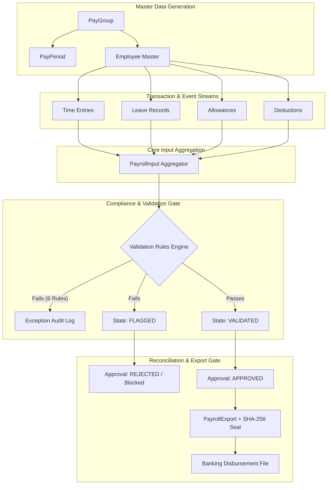
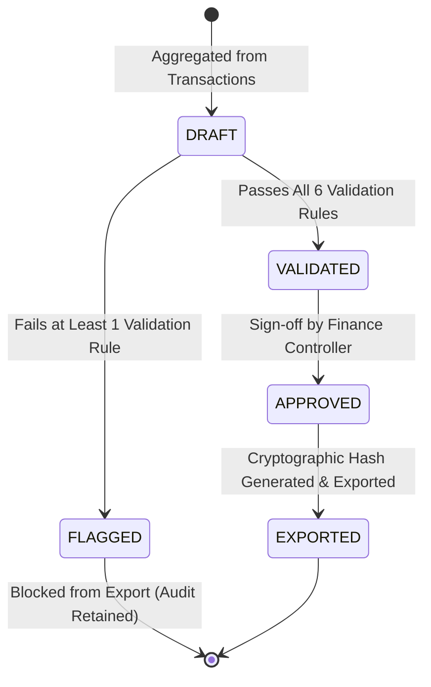
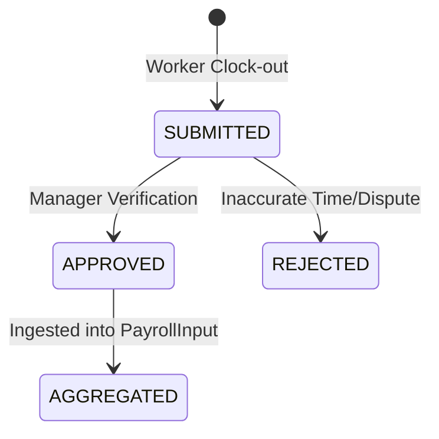

# System Architecture & Business Validation Engine

## 1. Architectural Overview

The Payroll Pre-Export Validation and Reconciliation Engine is designed around **zero financial leakage**, **deterministic auditability**, and **strict separation of concerns**. 

---

## 2. The 6 Core Business Validation Rules

| Rule ID | Rule Name | Category | Condition / Invariant | Action on Failure |
| :--- | :--- | :--- | :--- | :--- |
| **`RULE-001`** | Hours Exceed Maximum | `HOURS_THRESHOLD` | Total period hours $\le 200.0$ and daily hours $\le 16.0$ | Flags PayrollInput; logs `HOURS_EXCEED_MAXIMUM` |
| **`RULE-002`** | Duplicate Allowance | `DUPLICATE_CHECK` | No employee can receive $>1$ identical allowance type in the same period | Flags Allowance; logs `DUPLICATE_ALLOWANCE` |
| **`RULE-003`** | Unapproved Time Ingestion | `COMPLIANCE` | All timesheet entries must carry status `APPROVED` | Flags TimeEntry; logs `UNAPPROVED_TIME_EXPORTED` |
| **`RULE-004`** | Double Leave Deduction | `RECONCILIATION` | An unpaid leave record (`LEV-...`) can only be deducted once | Flags Deduction; logs `DOUBLE_LEAVE_DEDUCTION` |
| **`RULE-005`** | Arithmetic Reconciliation | `RECONCILIATION` | $\text{Gross} = \text{Base} + \text{Overtime} + \text{Allowances}$ ($\text{Variance} \le 0.01$) | Flags PayrollInput; logs `RECONCILIATION_MISMATCH` |
| **`RULE-006`** | Missing Bank/Tax Info | `COMPLIANCE` | Active employees must have valid `bank_account_no`, `bank_ifsc`, `tax_id` | Blocks export; logs `MISSING_BANK_TAX` |

---

## 3. Entity Lifecycle State Machines

### 3.1 PayrollInput Lifecycle

### 3.2 TimeEntry Lifecycle

---

## 4. Cryptographic Reconciliation Sealing

To ensure complete end-to-end immutability and SOX compliance:
1. Every exported record in `payroll_exports` receives a deterministic SHA-256 seal:
   $$\text{Hash} = \text{SHA256}(\text{ExportID} \parallel \text{InputID} \parallel \text{EmpID} \parallel \text{GrossPay} \parallel \text{NetPay} \parallel \text{Timestamp})$$
2. Banking systems and internal auditors can recompute this hash against the database ledger at any time to guarantee that figures were not tampered with post-approval.

---

## 5. Non-Destructive Event History

State changes never overwrite source history:
- When a time entry is corrected, the `version` counter increments rather than mutating the original row.
- When an anomaly is detected, an explicit immutable `Exception` event is logged in the `exceptions` table with full diagnostic metadata.
- Blocked records remain in `payroll_inputs` with status `FLAGGED`, allowing HR and finance partners to remediate without deleting transactions.
